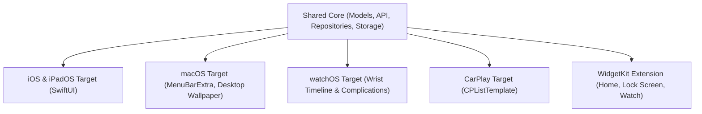

# AGENTS.md — Let's Solat Apple Platform Developer & Agent Guide

> **Welcome AI Agents & Contributors!**  
> This file is the primary context map for **Let's Solat (Apple Multiplatform)**. It outlines architecture, module organization, data flow, background jobs, critical development conventions, and the implementation roadmap for **iOS, iPadOS, macOS, watchOS, and CarPlay**.

---

## 1. Project Overview

**Let's Solat** is a native multiplatform Apple application (iOS, iPadOS, macOS, watchOS, and CarPlay) tailored for Malaysian Muslims to get accurate prayer times (Waktu Solat) according to JAKIM (Jabatan Kemajuan Islam Malaysia) zones, plus worldwide prayer times computed when abroad.

Key capabilities:
- Automatic prayer zone detection using GPS coordinates and geofences (`CoreLocation`).
- Background scheduled notifications via exact calendar triggers (`UNUserNotificationCenter`) and rich Adhan alerts with bundled audio.
- Dynamic Islamic Wallpaper Studio & Automation (Quran / Hadith in English & Malay with high-res architectural backgrounds). On macOS, native desktop wallpaper automation via `NSWorkspace.shared.setDesktopImageURL`.
- macOS Menu Bar resident extra (`MenuBarExtra`) showing active prayer countdowns and daily schedules.
- watchOS companion app with live Smart Stack and WidgetKit complications synced via `WatchConnectivity`.
- CarPlay (`CPTemplateApplicationSceneDelegate`) dashboard integration showing active prayer countdowns and daily schedules.
- Auto-Silent / Focus scheduling integration via App Intents & Shortcuts.
- Offline-first caching via App Group storage.

---

## 2. Multiplatform Architecture



### Module Responsibilities

1. **Shared Core**
   - **Models**: `PrayerTime`, `Location`, `Zone`, `HadithQuote`, `WallpaperConfig`.
   - **Networking**: `APIClient` wrapping `URLSession` with Bearer token authentication and JSON decoding.
   - **Local Storage**: `AppGroupStorage` wrapping `UserDefaults` / `SwiftData` for shared widget/extension access.
   - **Repositories**:
     - `PrayerTimeRepository` — API querying for daily and monthly schedules, offline caching.
     - `QuoteRepository` — Daily and random quotes (Quran/Hadith in EN/MS) with offline fallback.
     - `SettingsRepository` — User preferences (notifications, auto-location, theme).
     - `LocationManager` — `CoreLocation` wrapper for GPS coordinate tracking and JAKIM zone resolution.
     - `NotificationManager` — `UNUserNotificationCenter` scheduler for prayer times.

2. **macOS Target**
   - `MenuBarExtra` resident status item displaying upcoming prayer countdown.
   - Menu bar popover with daily prayer timetable and quick settings.
   - `MacWallpaperService` for desktop wallpaper automation.

3. **iOS & iPadOS Target**
   - Adaptive SwiftUI interface with Floating Pill or Sidebar navigation.
   - Full prayer timetable, Qibla compass, and Wallpaper Studio.

4. **watchOS Target**
   - Compact SwiftUI wrist timeline with Digital Crown support.
   - Complication providers for watch faces.

5. **CarPlay Target**
   - `CPListTemplate` displaying prayer times formatted for automotive screens.

---

## 3. Core Backend API Integration Specs

All API endpoints are protected by **Laravel Sanctum** (`auth:sanctum`). Every request must include:
```http
Authorization: Bearer <SANCTUM_TOKEN>
Accept: application/json
```

Default token: `1|XVgvHUzdJDMJSi6hcLhsiqUKHJi8xd9qmv50yF8O9f81557b`

### 1. Prayer Times Endpoint
```http
GET https://letssolat.syedn.xyz/api/prayer-times?zone={ZONE}&type=daily&date=YYYY-MM-DD
# For coordinate lookup (outside or inside Malaysia):
GET https://letssolat.syedn.xyz/api/prayer-times?latitude={LAT}&longitude={LON}&type=daily&date=YYYY-MM-DD
```
- **Response Format**:
  Timestamps for `imsak`, `fajr`, `sunrise`, `dhuhr`, `asr`, `maghrib`, and `isha` are returned as **UTC millisecond epoch timestamps** (`Double` in Swift: `Date(timeIntervalSince1970: ms / 1000.0)`).

### 2. JAKIM Zone Lookup Endpoint
```http
GET https://letssolat.syedn.xyz/api/zones
```
- Returns all Malaysian states and nested zone keys (e.g., `WLY01`, `SGR01`).

### 3. Islamic Quotes Endpoint (Quran & Hadith)
```http
GET https://letssolat.syedn.xyz/api/quotes/daily?type={hadith|quran}&lang={en|ms}
GET https://letssolat.syedn.xyz/api/quotes/random?type={hadith|quran}&lang={en|ms}
```

---

## 4. Key Workflows & Lifecycle Patterns

### A. Location & Geofencing Flow
1. User enables auto-location or GPS detects a coordinate update via `CLLocationManager`.
2. Resolves coordinates to a JAKIM zone via API, stores current coordinates, and registers an exit geofence (`CLCircularRegion`).
3. When the user travels outside the zone radius, region exit triggers fetching the new zone and updating prayer times.

### B. Prayer Alarms & Notifications
1. `NotificationManager` schedules local notifications using `UNCalendarNotificationTrigger` matching the exact hour and minute of each prayer time.
2. Notifications trigger system sound or custom bundled Adhan audio.
3. A background task (`BGAppRefreshTask`) ensures notifications remain seeded for days in advance.

### C. macOS Menu Bar Extra
1. The app registers a `MenuBarExtra` scene displaying the icon and countdown: `Solat: Asr in 45m`.
2. Clicking opens a popover detailing today's prayer times, current prayer highlighted, location/zone badge, and refresh button.

---

## 5. Build, Test, and CI/CD Guidelines

### Commands
- **Compile for macOS**:
  ```bash
  xcodebuild -scheme MyApp -destination 'platform=macOS' CODE_SIGN_IDENTITY="" CODE_SIGNING_REQUIRED=NO CODE_SIGNING_ALLOWED=NO build
  ```
- **Compile for iOS Simulator**:
  ```bash
  xcodebuild -scheme MyApp -destination 'generic/platform=iOS Simulator' CODE_SIGN_IDENTITY="" CODE_SIGNING_REQUIRED=NO CODE_SIGNING_ALLOWED=NO build
  ```

### Rules & Conventions for Agents
1. **Preserve Comments & Logic**: Maintain existing comments and architectural patterns.
2. **Permission Safety**: Ensure CoreLocation (`NSLocationWhenInUseUsageDescription`) and UserNotifications authorizations are gracefully handled.
3. **Offline First**: All remote prayer data calls must fall back to cached data in `UserDefaults`. Never leave the UI in an unhandled error state when offline.
4. **Swift Concurrency**: Use `async`/`await` and `@MainActor` for UI-bound state updates.
